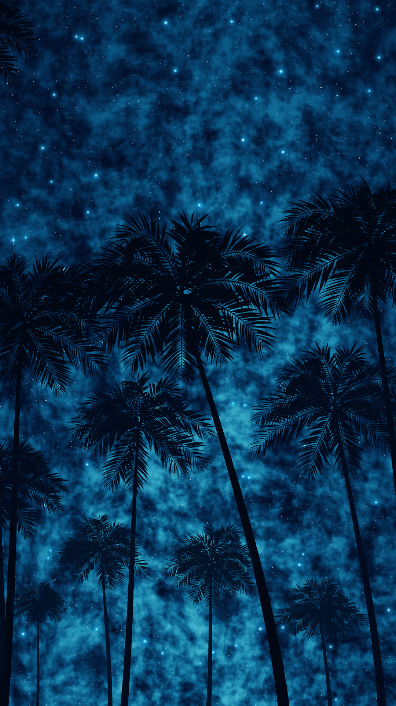

# Procedural Night Sky

A portrait night-sky artwork made from JavaScript drawing algorithms. The browser version begins as a dark canvas with one Play button; Play reveals the painting over 20 seconds. The project also includes a deterministic, code-and-art Instagram reel and scripts for exporting the artwork.

The scene contains a blue, noise-based nebula, 6,800 seeded stars, and 11 procedurally constructed palm trees. The source project does not use a finished background image or prerecorded painting footage to create the artwork.

## Preview



[View the 20-second creative-coding reel](exports/reel/creative-coding-reel.mp4). GitHub may show the MP4 as a downloadable file rather than play it inline.

## Technologies

- JavaScript ES modules, Node.js, and npm
- p5.js 1.11.11 to create and manage the standalone artwork canvas
- Canvas 2D for the pixel fields, stars, palm geometry, and painting compositing
- A Web Worker for preparing the sky field
- Vite 6.4.4 for local development and production builds
- Playwright 1.56.1 for browser automation and verification
- WebCodecs and `webm-muxer` 5.1.4 for frame-timed WebM encoding in supported browsers
- FFmpeg with the `libx264` encoder for H.264 MP4 conversion

The reel uses the browser Canvas 2D API and the same procedural painting modules. It is a deterministic edited visualization of the generation process. The sky field and drawing operations are prepared before playback, then revealed on the reel timeline; it is not a live coding session.

## Project files

```text
.
├── index.html                 Standalone artwork page
├── reel.html                  Reel composition page
├── package.json               Commands and direct dependencies
├── package-lock.json          Locked dependency tree for npm ci
├── vite.config.js             Vite build configuration
├── src/
│   ├── config.js              Canvas size, frame rate, duration, and default seed
│   ├── main.js                Artwork playback and internal PNG/WebM export API
│   ├── animation.js           Timed painting operations and compositing
│   ├── sky.js                 Seeded sky and noise-field calculations
│   ├── sky.worker.js          Background sky preparation worker
│   ├── nebula.js              Nebula field generation
│   ├── stars.js               Seeded star placement and drawing
│   ├── palmTrees.js           Palm trunks, fronds, leaves, and coconuts
│   ├── reel.js                Reel layout, timeline, and source excerpts
│   └── style.css              Minimal full-screen presentation
├── scripts/
│   ├── export.mjs             PNG, WebM, and MP4 artwork export
│   └── export-reel.mjs        Reel audit, rendering, and MP4 export
├── tests/verify.mjs           Browser-based artwork verification
├── licenses/                  License texts for direct dependencies
├── THIRD-PARTY-NOTICES.md     Dependency and external-tool notices
└── exports/
    ├── nocturne-731204.png    Seed 731204 artwork preview
    └── reel/creative-coding-reel.mp4
                                Final reel preview
```

Generated exports and test diagnostics are ignored by Git, except for the two preview files above. You can regenerate them with the commands below.

## Requirements

No API keys, accounts, credentials, or `.env` configuration are required to run or export this project. Use Node.js 18, 20, or 22 and newer supported releases (Vite's declared engine range is `^18.0.0 || ^20.0.0 || >=22.0.0`). Node.js 22.22.0 with npm 10.9.4 was used to verify this project.

For the standalone app, use a current Chromium-based browser such as Microsoft Edge or Google Chrome. The command-line artwork export uses Playwright to open Edge by default; it can use Chrome when requested. The reel export and browser tests currently launch Microsoft Edge specifically.

For MP4 export, install FFmpeg and ensure `ffmpeg` and `ffprobe` are on your `PATH`. The scripts require FFmpeg's `libx264` encoder. Browser video encoding also requires a browser with WebCodecs support for the reproducible frame-timed WebM path.

The same npm commands are intended for Windows, macOS, and Linux, but this project has only been tested on Windows. Browser installation and FFmpeg installation differ by operating system; macOS and Linux export workflows have not been verified here.

## Install and run

Open a terminal in the project directory and install the exact dependency versions from the lockfile:

```sh
npm ci
```

Start the local development server:

```sh
npm run dev
```

Open the local address printed by Vite (by default, `http://127.0.0.1:5173/`). The app initially shows the dark portrait canvas and a centered Play button. Click Play to watch the 20-second painting. At the end, the finished artwork remains on screen. Press Space to restart the animation.

To make and serve a production build locally:

```sh
npm run build
npm run preview
```

Vite prints the preview address (usually `http://127.0.0.1:4173/`).

## Seeds and new artwork

The default seed is `731204`. A seed controls the pseudo-random placement and geometry so the same seed reproduces the same arrangement. Set another unsigned 32-bit integer in the URL to explore a different scene:

```text
http://127.0.0.1:5173/?seed=42
```

You can also change `defaultSeed` in `src/config.js`. The supported seed range for command-line export is 0 through 4294967295. Reload after changing the URL or configuration to generate that scene.

## Export the artwork

The export script starts its own temporary Vite server and browser. From the project directory, run:

```sh
npm run export -- --seed=731204 --out=exports/generated
```

This writes `nocturne-731204.png`, `nocturne-731204.webm`, and `nocturne-731204.mp4` into `exports/generated/`. Use a different integer after `--seed=` to generate another artwork. Use another directory after `--out=` if you want to keep separate exports. The default output directory is `exports/`; exporting the default seed there replaces the same-named preview files.

By default the script launches Microsoft Edge. To use installed Google Chrome instead:

```sh
npm run export -- --seed=42 --out=exports/seed-42 --browser=chrome
```

The PNG is the finished 1080 × 1920 canvas. The browser encoder writes a 20-second, 30 FPS WebM with explicit frame timestamps. FFmpeg then converts the WebM to an H.264 MP4. The export captures canvas pixels only, so the Play button and browser interface are not in the video.

## Reproduce the Instagram reel

With Microsoft Edge and FFmpeg (`libx264`) installed, run:

```sh
npm run export:reel
```

The script writes `creative-coding-reel.mp4` and intermediate WebM and diagnostic files under `exports/reel/`. It checks that displayed code excerpts appear in the indicated source files, validates the excerpt syntax and timeline mapping, and verifies the finished MP4 dimensions, frame rate, frame count, and duration. The video is 1080 × 1920, 30 FPS, and 20 seconds (600 frames). Its source excerpts are taken from the project; the reel is an edited visualization of the process, not a recording of a person typing code as the artwork is computed.

## Verification

Start the development server in one terminal:

```sh
npm run dev
```

Then, in a second terminal, run:

```sh
npm test
```

The test opens a visible Microsoft Edge browser at `http://127.0.0.1:5173/`. It checks the initial canvas and Play button, 20-second playback, the final image against the saved PNG, the final hold, responsive sizing, Space restart, PNG export, and browser errors. Screenshots and the test export are saved under `test-results/`.

Build the production bundle with `npm run build`. The build includes both the artwork page and reel page.

## Troubleshooting

- **`npm ci` reports an unsupported Node version:** install Node.js 18, 20, or 22+ within Vite's engine range, then retry.
- **The page does not load:** confirm `npm run dev` is still running and open the exact URL Vite printed. If port 5173 is occupied, stop the other server before starting the test; the test expects that port.
- **Playwright cannot launch Edge:** install Microsoft Edge. The standalone export supports installed Chrome with `--browser=chrome`, but tests and reel export currently require Edge.
- **Export reports that FFmpeg is missing:** install FFmpeg and add its `bin` directory to `PATH`, then open a new terminal and verify `ffmpeg -version` works.
- **MP4 conversion fails with an encoder error:** use an FFmpeg build that includes `libx264`; check with `ffmpeg -encoders`.
- **WebM export is unavailable:** use a recent Edge or Chrome release with WebCodecs support. The command-line export needs its WebCodecs WebM path before it can convert to MP4.
- **The browser test fails before opening the app:** start `npm run dev` in another terminal first. Keep Edge installed because the test script selects it explicitly.

## Development & AI Assistance

The project creator provided the creative concept and visual direction. AI-assisted coding tools, including OpenAI Codex, helped implement and refine the project. JavaScript algorithms procedurally generate the artwork. The final animation is an edited visualization of the creative-coding process, not a live coding session. The source was developed with AI assistance; this project does not claim that every line was written manually.

## Third-party software and licensing

See [THIRD-PARTY-NOTICES.md](THIRD-PARTY-NOTICES.md) and the included `licenses/` texts for the audited direct dependencies. p5.js is distributed under LGPL-2.1; webm-muxer under MIT; Vite under MIT; and Playwright under Apache-2.0. FFmpeg and its `libx264` encoder are installed separately and are not bundled here. Their distribution terms depend on the FFmpeg build you install.

The original project code and artwork have no project license file yet. Third-party dependency licenses do not grant a license to reuse the creator's original code or artwork. No license has been added pending the creator's approval. My recommendation is the [MIT License](https://opensource.org/license/mit) for the project source code and documentation if broad reuse is intended. Decide separately whether to keep the artwork and video under the creator's existing copyright or allow reuse with attribution; Creative Commons recommends against using its licenses for software, while it does allow them for separate artistic works ([CC FAQ](https://creativecommons.org/faq/index.html)).
